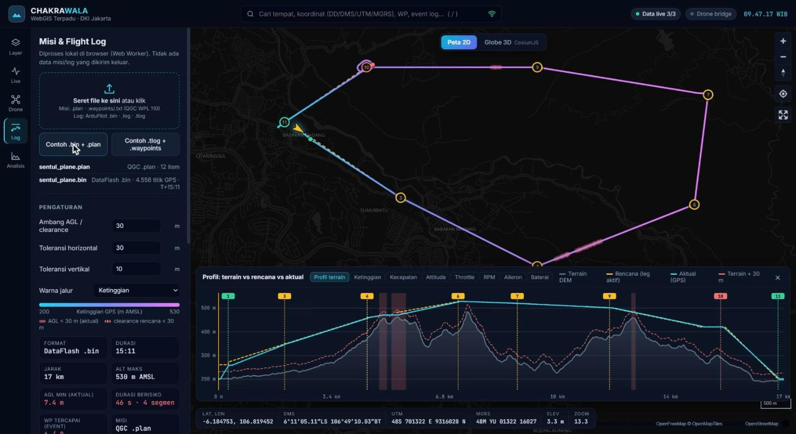
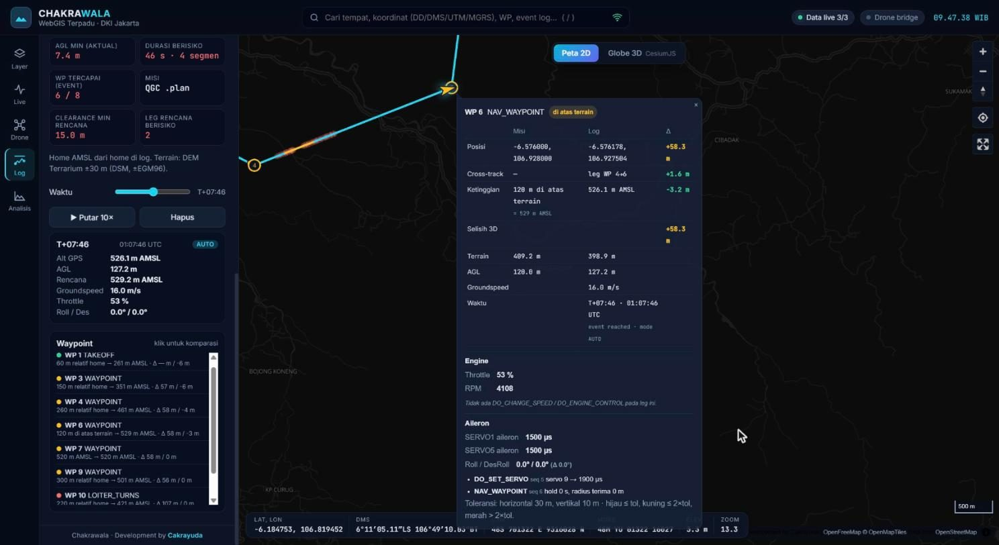
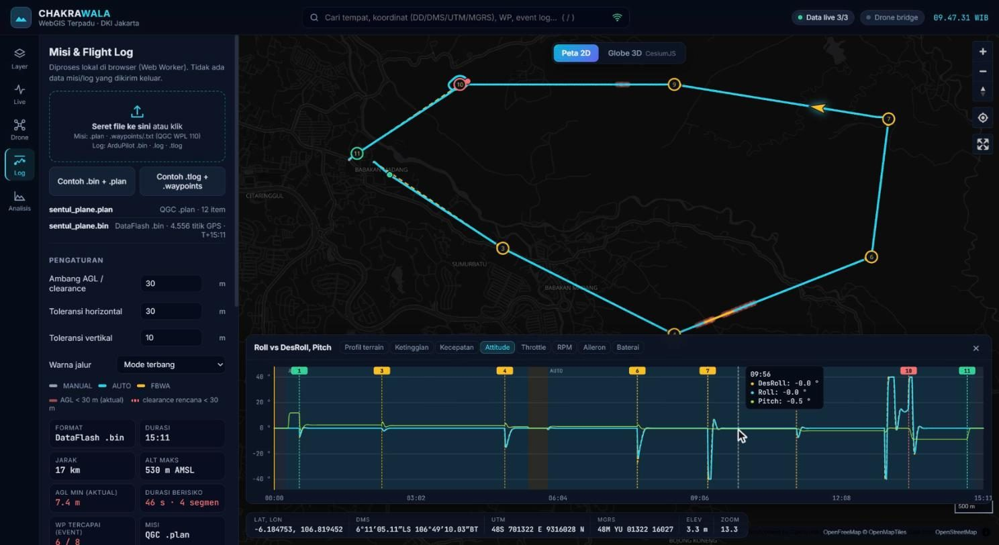
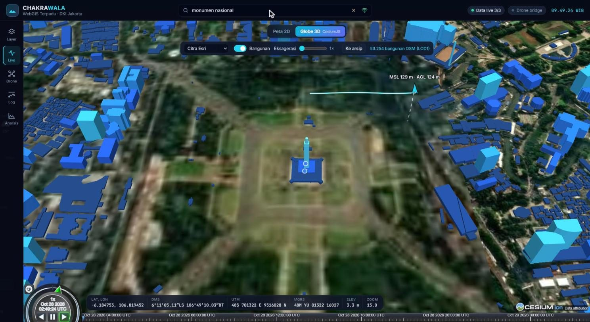
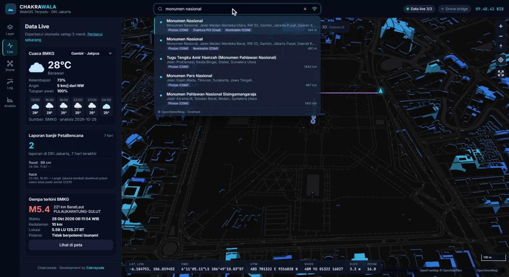
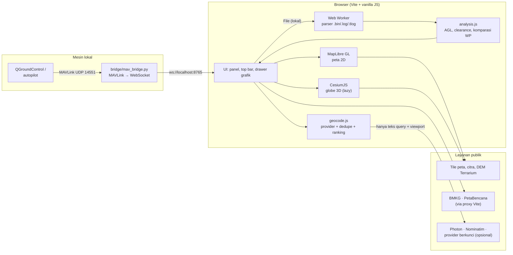

<div align="center">

# Chakrawala

**WebGIS terpadu untuk Jakarta — peta 2D/3D, data live, telemetri drone, serta analisis misi & flight log terhadap terrain.**

[](https://nodejs.org/)
[](https://www.python.org/)
[](https://vite.dev/)
[](https://maplibre.org/)
[](https://cesium.com/platform/cesiumjs/)
[](#pengujian)
[](LICENSE)
[](#prasyarat)



</div>

> Semua screenshot di dokumen ini dibuat dari **data demo sintetis** (`web/public/demo/`), bukan data penerbangan nyata.

## Daftar isi

- [Fitur](#fitur)
- [Arsitektur](#arsitektur)
- [Prasyarat](#prasyarat)
- [Instalasi](#instalasi)
- [Setup & konfigurasi API key](#setup--konfigurasi-api-key)
- [Penggunaan](#penggunaan)
- [Pengujian](#pengujian)
- [Struktur proyek](#struktur-proyek)
- [Privasi & data](#privasi--data)
- [Troubleshooting](#troubleshooting)
- [Panduan pengguna (PDF)](#panduan-pengguna-pdf)
- [Lisensi](#lisensi)

## Fitur

| Area | Kemampuan |
| --- | --- |
| **Peta 2D** | MapLibre GL, basemap vektor gelap (OpenFreeMap/OSM), bangunan 3D, citra Esri & Sentinel-2, hillshade, terrain 3D, swipe komparasi citra. Setiap layer menampilkan sumber, resolusi, lisensi, dan **umur data**. |
| **Koordinat** | Kursor dalam DD, DMS, UTM 48S, MGRS, plus elevasi DEM. |
| **Data live** | Cuaca BMKG per kelurahan, laporan banjir PetaBencana, gempa terkini BMKG (refresh 5 menit). |
| **Drone live** | Jembatan MAVLink → WebSocket (Python). HUD MSL/AGL/kecepatan/baterai/mode/GPS, jejak berwarna, peringatan AGL, grafik live, mode simulasi. |
| **Misi** | Import QGC `.plan` dan Mission Planner `.waypoints`/`.txt` (QGC WPL 110) ke satu model ternormalisasi; frame `GLOBAL`, `RELATIVE_ALT`, `TERRAIN_ALT` diselesaikan ke AMSL. |
| **Flight log** | ArduPilot `.bin`, `.log` (teks), `.tlog` (MAVLink 1/2, CRC diverifikasi) di **Web Worker** dengan downsampling min-max. |
| **Analisis** | Profil terrain vs rencana vs aktual, AGL, clearance minimum, segmen berisiko (ambang bisa diatur), grafik time-series tersinkron dengan peta lewat cursor waktu. |
| **Komparasi waypoint** | Popup misi vs log: posisi, cross-track, selisih 3D/ketinggian, groundspeed, waktu; engine (throttle, RPM, `DO_CHANGE_SPEED`/`DO_ENGINE_CONTROL`); aileron/elevon (`SERVOn_FUNCTION`, Roll vs DesRoll, `DO_SET_SERVO`). Data yang tidak ada ditulis "tidak tersedia". |
| **Pencarian** | Antarmuka `GeocodingProvider`: Photon & Nominatim (default/fallback), POI Overture lokal, opsional Mapbox/MapTiler/HERE/Geoapify/Google Places. Query paralel, dedupe, ranking, sumber ditampilkan, mode offline. Input DD/DMS/UTM/MGRS diproses lokal. |
| **Globe 3D** | CesiumJS tanpa token ion: terrain DEM yang sama dengan 2D, bangunan OSM LOD1, drone live & replay arsip 3D. |

<table>
<tr>
<td><br/><sub>Popup komparasi waypoint (misi vs log)</sub></td>
<td><br/><sub>Attitude & pita mode terbang, tersinkron ke peta</sub></td>
</tr>
<tr>
<td><br/><sub>Globe 3D CesiumJS dengan jejak drone simulasi</sub></td>
<td><br/><sub>Pencarian multi-provider dengan sumber</sub></td>
</tr>
</table>

## Arsitektur



Data misi dan log **tidak pernah** dikirim ke luar browser; yang dikirim ke provider geocoding hanya teks pencarian dan viewport.

## Prasyarat

| Komponen | Versi | Keterangan |
| --- | --- | --- |
| [Node.js](https://nodejs.org/) | **22 LTS** atau lebih baru (lihat `.nvmrc`) | npm ikut terpasang |
| [Python](https://www.python.org/downloads/) | 3.10+ | Hanya untuk bridge drone & alat bantu (opsional) |
| Browser | Chrome / Edge / Firefox terbaru dengan WebGL 2 | Peta 2D & globe 3D |
| Git | apa saja | untuk clone |

Berjalan di **Windows, macOS, dan Linux**; semua skrip npm memakai Node sehingga tidak bergantung pada shell tertentu.

## Instalasi

```bash
git clone https://github.com/songohaji99/gcs-terrain-log-analyzer.git
```

```bash
cd gcs-terrain-log-analyzer
```

```bash
npm run setup
```

`npm run setup` menjalankan `npm ci` di folder `web/` (sesuai `package-lock.json`) dan menyalin aset CesiumJS ke `web/public/cesium/` secara otomatis.

Jalankan aplikasi:

```bash
npm run dev
```

Buka **http://localhost:5173**. Untuk build produksi:

```bash
npm run build
```

```bash
npm run preview
```

### Bridge drone (opsional, Python)

Disarankan memakai virtual environment di folder proyek (`.venv`). Skrip npm otomatis memakai `.venv` bila ada, jadi **tidak perlu diaktifkan**.

macOS / Linux:

```bash
python3 -m venv .venv
```

Windows:

```powershell
python -m venv .venv
```

Lalu, dari folder proyek:

```bash
npm run bridge:install
```

```bash
npm run bridge:sim
```

Mode live: di QGroundControl buka **Application Settings → MAVLink → MAVLink forwarding**, aktifkan dan arahkan ke `IP_KOMPUTER:14551`, lalu jalankan `npm run bridge:live`. Setiap sesi terekam ke `bridge/logs/flight_*.csv` (tidak ikut ke git).

## Setup & konfigurasi API key

Semua key **opsional**. Tanpa key, pencarian memakai Photon + Nominatim (+ POI Overture bila ekstraknya dibuat).

1. Salin contoh konfigurasi:

   ```bash
   node -e "require('fs').copyFileSync('web/.env.example','web/.env')"
   ```

2. Isi key yang dimiliki di `web/.env`:

   | Variabel | Provider | Catatan |
   | --- | --- | --- |
   | `VITE_GEOCODERS` | — | Urutan/prioritas provider |
   | `VITE_MAPBOX_TOKEN` | Mapbox Search | autocomplete |
   | `VITE_MAPTILER_KEY` | MapTiler Geocoding | autocomplete |
   | `VITE_HERE_API_KEY` | HERE Autosuggest | autocomplete |
   | `VITE_GEOAPIFY_KEY` | Geoapify | autocomplete |
   | `VITE_GOOGLE_PLACES_KEY` | Google Places (New) | hanya pencarian penuh |
   | `VITE_PHOTON_URL`, `VITE_NOMINATIM_URL` | self-host | disarankan untuk produksi/offline |
   | `VITE_NOMINATIM_EMAIL` | Nominatim publik | identitas kontak sesuai kebijakan OSMF |
   | `VITE_OVERTURE_URL` | POI lokal | default `/data/overture_places.json` |

3. Restart `npm run dev`.

> Variabel `VITE_*` ikut ter-bundle ke browser. Gunakan key yang **dibatasi per domain/referrer** di konsol provider. `web/.env` sudah di-ignore git — jangan commit key.

### POI Overture untuk pencarian offline (opsional)

```bash
npm run tools:install
```

```bash
node scripts/py.mjs tools/overture_download.py --bbox 106.76,-6.26,106.90,-6.12
```

Hasilnya `web/public/data/overture_places.json` (di-ignore git, dibangun ulang di setiap mesin).

## Penggunaan

| Langkah | Cara |
| --- | --- |
| Coba tanpa data sendiri | Menu **Log** → **Contoh .bin + .plan** atau **Contoh .tlog + .waypoints**; menu **Drone → Arsip** → **Muat contoh** |
| Analisis misi | Seret `.plan` / `.waypoints` / `.txt` ke menu **Log** |
| Analisis log | Seret `.bin` / `.log` / `.tlog`; bila tanpa misi, misi diambil dari log |
| Grafik | Tab di drawer: Profil terrain, Ketinggian, Kecepatan, Attitude, Throttle, RPM, Aileron, Baterai |
| Komparasi waypoint | Klik marker WP di peta/grafik atau baris di daftar Waypoint |
| Pencarian | `/` untuk fokus, `↑/↓` pilih, `Enter` buka, `Shift+Enter` pencarian penuh, `Esc` tutup |
| Globe 3D | Tombol **Globe 3D** di atas peta |

Data demo dibuat ulang dengan `npm run demo:generate` (butuh `npm run tools:install`).

## Pengujian

```bash
npm test
```

```bash
npm run lint
```

```bash
npm run check
```

28 unit test (`node:test`) mencakup parser misi (`.plan` ≡ `.waypoints`), parser log (`.bin`/`.log`/`.tlog` dan file rusak), analisis (target leg, AGL, segmen berisiko, komparasi waypoint), parser koordinat, serta gabung/dedupe/ranking geocoding dengan provider di-mock. `npm run check` = lint + test + build.

## Struktur proyek

```text
.
├── web/                      # Aplikasi (Vite)
│   ├── index.html
│   ├── src/
│   │   ├── main.js           # peta, layer, koordinat, tab
│   │   ├── flightlog.js      # menu Log (misi + flight log)
│   │   ├── analysis.js       # AGL, clearance, komparasi waypoint
│   │   ├── mission.js        # parser .plan / WPL 110
│   │   ├── logparse.js       # parser .bin / .log / .tlog
│   │   ├── logworker.js      # Web Worker parser
│   │   ├── mavlink-defs.js   # di-generate dari pymavlink
│   │   ├── geocode.js        # GeocodingProvider + dedupe/ranking
│   │   ├── search.js         # UI pencarian
│   │   ├── cesium3d.js       # globe 3D
│   │   ├── drone.js, live.js, profile.js, chart.js, geo.js, elevation.js, parsers.js
│   │   └── *.test.js         # unit test
│   ├── public/demo/          # data demo SINTETIS (aman dipublikasikan)
│   ├── scripts/copy-cesium.mjs
│   └── .env.example
├── bridge/mav_bridge.py      # MAVLink → WebSocket (sim & live)
├── tools/                    # generator demo, defs MAVLink, Overture, PDF panduan
├── scripts/py.mjs            # runner Python lintas OS
├── docs/                     # screenshot, panduan PDF, riset
└── package.json              # skrip root (setup, dev, test, build, ...)
```

## Privasi & data

- File misi/log diproses **di browser** (Web Worker); tidak ada unggahan ke server.
- `.gitignore` menolak semua `*.bin`, `*.log`, `*.tlog`, `*.ulg`, `*.plan`, `*.waypoints`, folder `samples/` dan `data/`, `.env`, cache DEM/tile, `node_modules`, `venv`, hasil build, serta file OS/IDE. Satu-satunya pengecualian adalah `web/public/demo/` yang berisi data **sintetis** hasil `tools/gen_samples.py`.
- Atribusi data pihak ketiga: © OpenStreetMap contributors (ODbL), OpenFreeMap/OpenMapTiles, Esri World Imagery (tampilan saja), EOX Sentinel-2 cloudless (CC BY-NC-SA 4.0), Mapzen Terrarium, BMKG, PetaBencana.id, Overture Maps.

## Troubleshooting

| Gejala | Solusi |
| --- | --- |
| `npm run setup` gagal karena versi Node | Pasang Node 22 LTS (`nvm use` membaca `.nvmrc`). Cek dengan `node -v`. |
| `EBADENGINE` / test tidak menemukan file | Node < 22 tidak mendukung glob pada `node --test`; upgrade Node. |
| Globe 3D gagal dimuat | Pastikan `web/public/cesium/` ada — jalankan ulang `npm run setup`. |
| Port 5173 sudah dipakai | Hentikan proses lain atau jalankan `npm --prefix web run dev -- --port 5174`. |
| "Data live 0/3" | Koneksi internet/proxy diblokir. Di server produksi, sediakan rute `/api/pb`, `/api/bmkg`, `/api/gempa` (lihat `web/vite.config.js`). |
| "Drone bridge" merah | Bridge belum berjalan: `npm run bridge:sim`. Aplikasi menyambung ulang tiap 3 detik. |
| Windows: `pip` gagal dengan `OSError ... Long Path` saat `bridge:install` | Clone ke folder yang lebih pendek (mis. `C:\src\`) atau aktifkan *Windows Long Path support* (lihat pesan pip). |
| `Python 3.10+ tidak ditemukan` | Pasang Python dan pastikan `python3` (macOS/Linux) atau `python`/`py` (Windows) ada di PATH. |
| Log ditolak: "tidak ada data GPS dengan fix 3D" | Log direkam tanpa fix GPS. Gunakan log dengan penerbangan bergerak. |
| `.ulg` ditolak | PX4 ULog belum didukung; gunakan log ArduPilot atau `.tlog`. |
| Pencarian kosong | Provider online gagal/rate limit — coba `Shift+Enter`, periksa ikon offline (kuning = offline). |

## Panduan pengguna (PDF)

Panduan langkah demi langkah tersedia di [`docs/Chakrawala-Panduan-Pengguna.pdf`](docs/Chakrawala-Panduan-Pengguna.pdf), dibangun dari dokumentasi ini dan screenshot sintetis:

```bash
npm run docs:pdf
```

## Lisensi

Dirilis di bawah [lisensi MIT](LICENSE). Hak cipta © 2026 Cakrayuda.

---

<div align="center"><sub>Chakrawala · Development by <b>Cakrayuda</b></sub></div>
<!-- Chakrawala — Development by Cakrayuda -->
