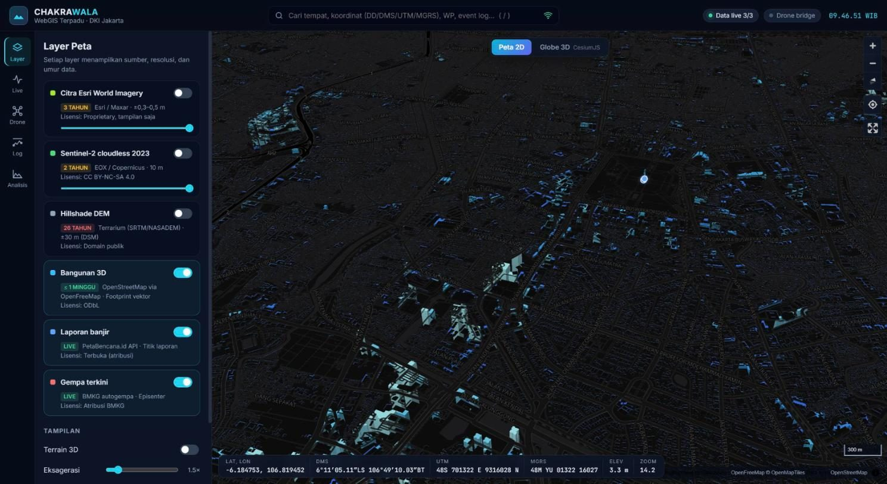
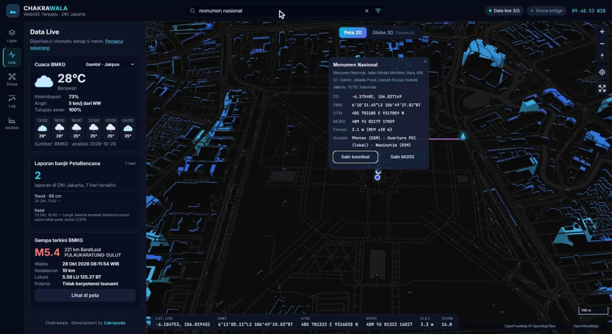
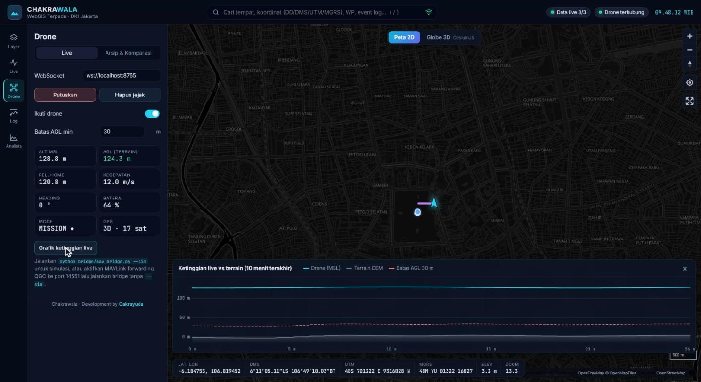
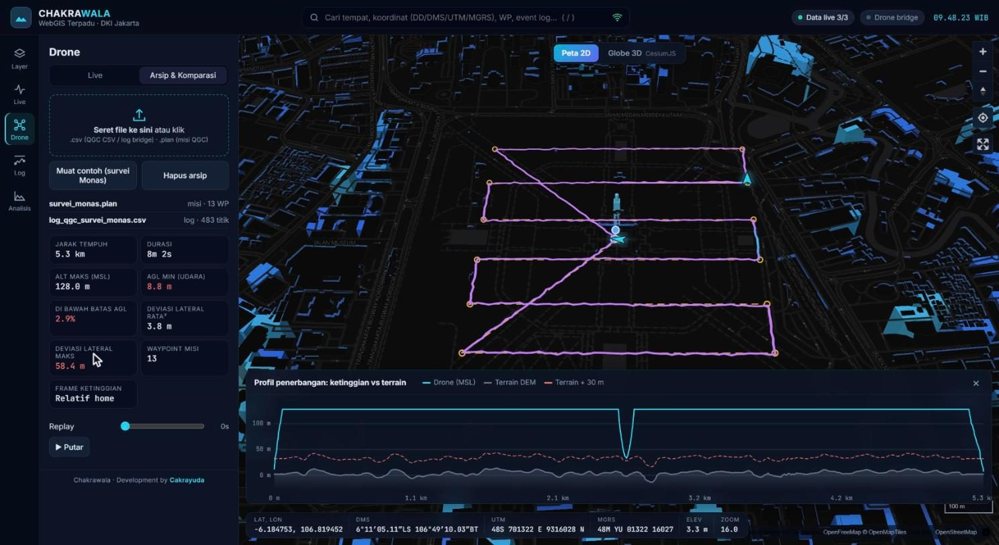
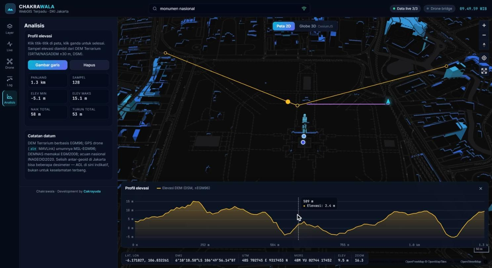

# Panduan Pengguna Chakrawala

Panduan langkah demi langkah memakai **data demo sintetis** yang ikut dalam repositori (`web/public/demo/`). Jalankan aplikasi lebih dulu (`npm run setup` lalu `npm run dev`) dan buka http://localhost:5173.

## Langkah 1 — Mengenal tampilan

Saat dibuka, peta 2D menampilkan Jakarta Pusat dengan bangunan 3D. Rail ikon di kiri berisi menu **Layer, Live, Drone, Log, Analisis**; klik ikon yang aktif sekali lagi untuk menutup panel. Bar bawah menampilkan koordinat kursor dalam DD, DMS, UTM, MGRS, dan elevasi DEM.

1. Buka http://localhost:5173.
2. Tunggu chip **Data live 3/3** di kanan atas menyala hijau.
3. Arahkan kursor ke peta untuk membaca koordinat.

## Langkah 2 — Data live & pencarian tempat

Menu **Live** menampilkan cuaca BMKG, laporan banjir PetaBencana, dan gempa terkini BMKG. Kotak pencarian di atas menggabungkan beberapa provider dan menampilkan sumber setiap hasil.

1. Klik ikon **Live**.
2. Klik kotak pencarian (atau tekan `/`), ketik `monumen nasional`, lalu tekan `Shift+Enter` untuk pencarian penuh.
3. Gunakan `↑/↓` dan `Enter` untuk memilih.

## Langkah 3 — Hasil pencarian & salin koordinat

Memilih hasil akan menerbangkan peta ke lokasi dan membuka popup berisi DD, DMS, UTM, MGRS, elevasi, dan sumber data. Koordinat yang diketik (DD/DMS/UTM/MGRS) diproses lokal tanpa internet.

1. Pilih hasil teratas.
2. Klik **Salin koordinat** atau **Salin MGRS**.

## Langkah 4 — Drone live (simulasi)

Bridge Python meneruskan telemetri MAVLink ke browser lewat WebSocket. Mode simulasi menerbangkan survei di atas Monas tanpa perangkat keras.

1. Jalankan `npm run bridge:install` lalu `npm run bridge:sim` di terminal terpisah.
2. Klik ikon **Drone** → **Live** → **Hubungkan**.
3. Klik **Grafik ketinggian live**; atur **Batas AGL min** sesuai kebutuhan.

## Langkah 5 — Arsip CSV & rencana misi

Tab **Arsip & Komparasi** membandingkan log CSV QGroundControl dengan rencana misi: profil ketinggian, persentase di bawah batas AGL, dan deviasi lateral.

1. Klik **Drone** → **Arsip & Komparasi**.
2. Klik **Muat contoh (survei Monas)**.
3. Gunakan slider **Replay** atau tombol **Putar**.

## Langkah 6 — Analisis misi & flight log

Menu **Log** menerima misi `.plan` / `.waypoints` / `.txt` dan log ArduPilot `.bin` / `.log` / `.tlog`. Semua file diproses di browser (Web Worker).

1. Klik ikon **Log**.
2. Klik **Contoh .bin + .plan** (atau seret file sendiri ke kotak unggah).
3. Baca kartu statistik: AGL minimum, durasi berisiko, WP tercapai, clearance minimum rencana.
4. Drawer **Profil terrain** menampilkan terrain DEM, ketinggian rencana, ketinggian aktual, dan pita segmen berisiko.

## Langkah 7 — Grafik tersinkron & warna per mode

Semua grafik memakai satu cursor waktu yang tersinkron dengan ikon pesawat di peta dan readout di panel.

1. Ubah **Warna jalur** menjadi **Mode terbang**.
2. Pilih tab **Attitude** (tersedia juga Ketinggian, Kecepatan, Throttle, RPM, Aileron, Baterai).
3. Arahkan kursor di grafik; pita latar menunjukkan mode terbang.

## Langkah 8 — Komparasi waypoint

Popup komparasi membandingkan rencana dengan kondisi aktual saat waypoint dicapai, termasuk engine dan aileron/elevon. Delta berwarna hijau bila dalam toleransi, kuning bila ≤ 2× toleransi, merah bila lebih.

1. Klik marker WP di peta, marker di grafik, atau baris di daftar **Waypoint**.
2. Atur **Toleransi horizontal** dan **Toleransi vertikal** di panel.

## Langkah 9 — Globe 3D

Globe CesiumJS memakai terrain DEM yang sama dengan peta 2D dan mengekstrusi bangunan OSM (LOD1) tanpa token Cesium ion.

1. Klik **Globe 3D** di atas peta.
2. Atur basemap, sakelar **Bangunan**, dan **Eksagerasi**.
3. Klik **Peta 2D** untuk kembali — kamera tetap di lokasi yang sama.

## Langkah 10 — Profil elevasi

Menu **Analisis** mengukur jarak dan profil elevasi DEM sepanjang garis bebas.

1. Klik ikon **Analisis** → **Gambar garis**.
2. Klik titik-titik di peta, klik ganda untuk selesai.
3. Arahkan kursor di grafik untuk melihat titik terkait di peta.

## Catatan akurasi

- Elevasi berasal dari DEM Terrarium (SRTM/NASADEM ±30 m, DSM, ±EGM96). AGL bersifat indikatif dan **bukan** untuk keselamatan terbang.
- Ketinggian GPS (AMSL) dan DEM dianggap sama-sama EGM96; acuan nasional INAGEOID2020 dapat berbeda beberapa desimeter.
- Bila tipe wahana tidak terdeteksi dari log, aplikasi mengasumsikan ArduPlane dan menampilkannya di panel.
